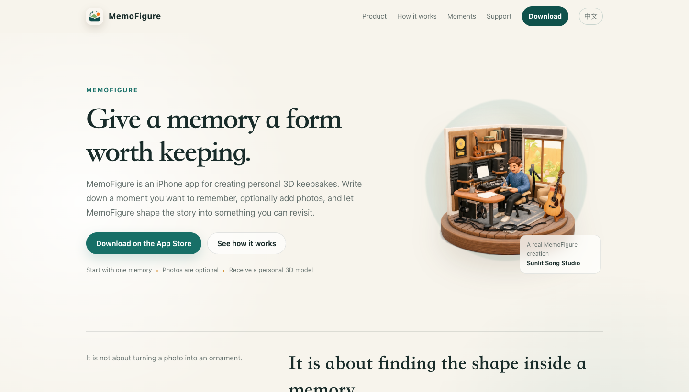
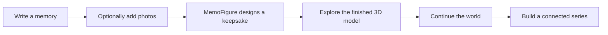
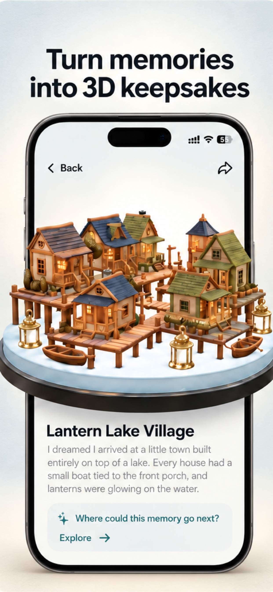
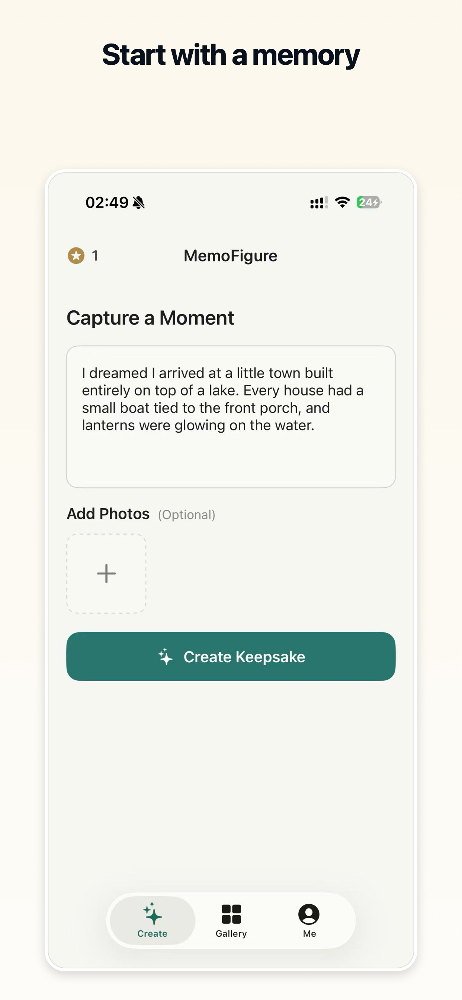
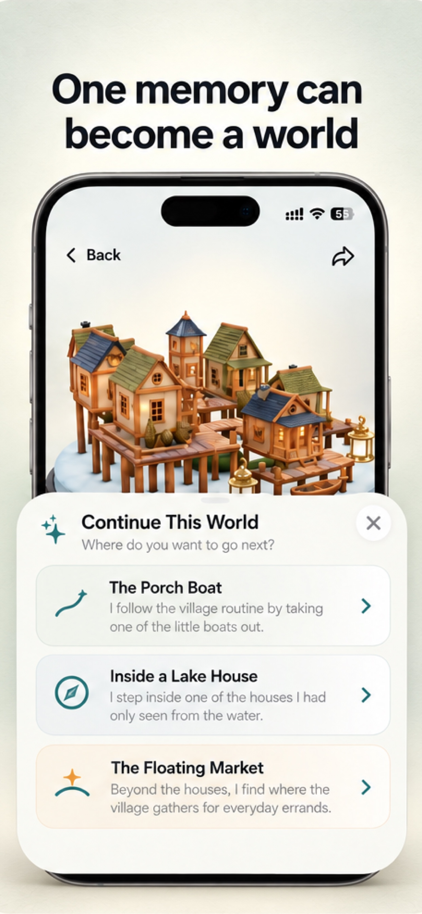
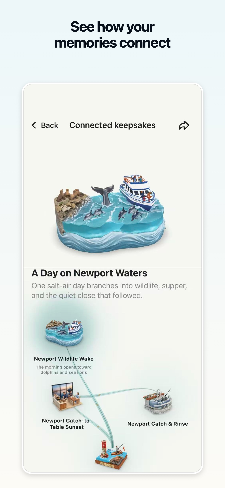
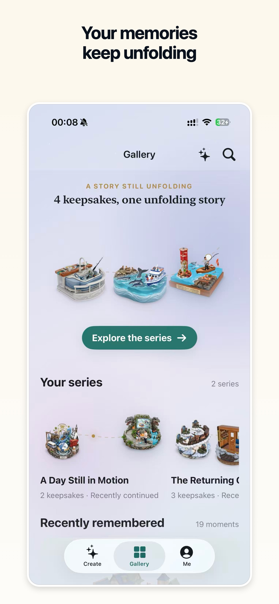
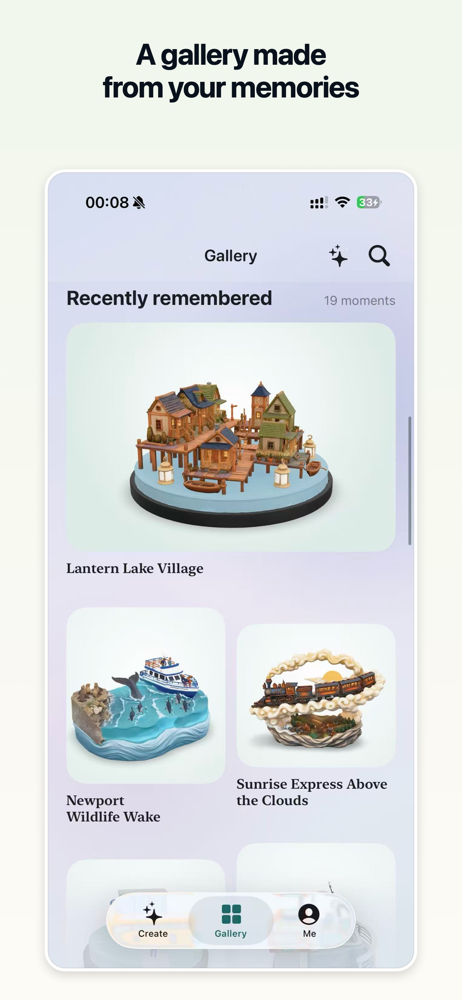

  

<h1 align="center">MemoFigure</h1>

<strong>Give a memory a form worth keeping.</strong>

  <a href="https://apps.apple.com/us/app/memofigure/id6787197327"><strong>Download on the App Store</strong></a>
  ·
  <a href="https://www.memofigure.com/en"><strong>Official website</strong></a>
  ·
  <a href="https://www.memofigure.com/en/support"><strong>Support</strong></a>

  

MemoFigure is an iPhone app that turns a written memory—and optional photos—into a personal 3D keepsake. People can revisit the finished model, continue the memory in new directions, and grow related keepsakes into a connected series.

This public repository is a product and engineering showcase. The application source remains private.

## Engineering at a glance

**Swift / SwiftUI · Node.js · Google Cloud Run · Cloud Tasks · WebKit 3D previews**

- **Asynchronous generation:** an API creates a job, then a private worker handles generation orchestration through Cloud Tasks.
- **Recoverable progress:** persisted task IDs, stage-based updates, and bounded polling retries let the app continue checking pending 3D tasks.
- **Collection and rendering:** per-user collection persistence, cached model assets, and viewport-based preview mounting support revisiting keepsakes.

Read the [engineering overview](docs/ENGINEERING.md) for the architecture, implementation decisions, trade-offs, and validation approach.

## Product experience

MemoFigure keeps the experience deliberately simple. A person writes naturally, adds photos only when useful, and returns to a keepsake made from that memory.

## Selected product screens

  
  
  

  
  
  

## My role

- Built and launched the SwiftUI iPhone app and its Node.js backend.
- Implemented the Cloud Run / Cloud Tasks pipeline, progress updates, task recovery, and collection persistence.
- Developed embedded 3D previews, caching, and gallery viewer-lifecycle handling.
- Designed the product experience and created the official website and App Store presentation.

Read the [product story](docs/CASE_STUDY.md) for the ideas behind the experience.

## Principles

- **Start with ordinary language.** People should describe a memory, not learn prompt syntax.
- **Photos stay optional.** The story remains the core input.
- **Make the process understandable.** Creative work should feel calm and clear.
- **Make the result revisitable.** A keepsake belongs in a personal collection rather than disappearing after generation.
- **Let memories grow.** A finished keepsake can become the beginning of a connected series.

## About this repository

This repository contains portfolio documentation and public marketing images only. The complete MemoFigure source repository remains private. No open-source license is granted; see [NOTICE](NOTICE.md).

