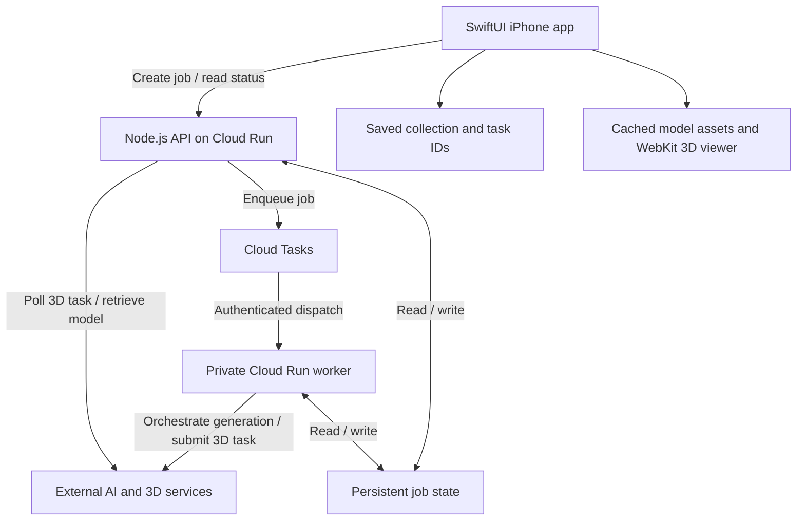

# MemoFigure: Engineering Overview

MemoFigure is an App Store iPhone app that turns written memories and optional photos into personal 3D keepsakes. I built the SwiftUI client and Node.js backend, including the asynchronous generation workflow, collection persistence, and embedded 3D previews.

This document describes selected implementation decisions for the MemoFigure cloud pipeline. The source code remains private; this repository contains public portfolio documentation and product assets.

## System overview

The client needs to stay responsive while external AI and 3D services perform work that can outlast an ordinary API request. I separated request handling from generation orchestration using Google Cloud Run and Cloud Tasks.

1. The API creates a job and returns an accepted response with a job ID.
2. Cloud Tasks dispatches generation work to a private worker. The worker advances the job through preparation and submission stages, preserving the external 3D task ID.
3. The app reads job status and then polls the 3D task through the API.
4. Once model assets are ready, the client loads them into the viewer and waits for rendering readiness before presenting the finished keepsake.

The worker completing submission is distinct from the external 3D task finishing and from the model becoming visible on the phone.

## Decisions and trade-offs

### Keep long-running work outside the client request

The API and worker have separate runtime roles. The public API runtime does not expose the worker processing route, and Cloud Tasks dispatch uses a service identity.

This separation lets the client receive a job reference without holding the initial request open for generation. It also introduces coordination work: job IDs, persisted stages, retries, and terminal states must stay consistent across the API, worker, and app.

### Recover by continuing an existing task

The collection stores the external task ID alongside each memory. When preparing the collection, the app finds pending tasks and resumes polling, while tracking active and already-resumed IDs to avoid starting duplicate polling loops.

Polling tolerates transient failures with bounded retry delays. Terminal errors remain distinct from a task that is still progressing. Resuming a pending task uses its existing ID rather than starting another generation request.

Memory records are saved per user with atomic local file writes. This supports restoring the collection and its pending-task references after the app is reopened.

### Separate generation progress from rendering readiness

A provider's progress percentage is not the same as a usable result on screen. MemoFigure maps backend stages into product progress and distinguishes:

- Generation and external task submission.
- Model availability and asset loading.
- A verified visible model in the embedded viewer.

The viewer reports loading and visibility events back to SwiftUI. Texture checks and recovery paths help handle cases where a model exists but its preview is still blank or incomplete.

### Bound the cost of a gallery of 3D previews

Interactive previews are more expensive than static collection cards. Gallery cards mount interactive WebViews when they are in the viewport and pause rendering when the collection is inactive or a detail view is open.

Local model caches and preview snapshots support revisiting keepsakes. The trade-off is accepting a cached reload when needed instead of retaining every live renderer indefinitely. The goal is reliable browsing as a collection grows.

## Validation approach

The private implementation includes a mocked integration regression for the cloud task flow. It checks the accepted job response, queue payload and job identity, authenticated dispatch configuration, the disabled worker route on the API runtime, and preservation of the external task ID after worker submission.

Additional source-level regression checks guard progress navigation, preview-cache behavior, viewport-based viewer mounting, and readiness callbacks. These complement device-based visual inspection; source checks alone cannot establish rendering quality on an iPhone.

## My contribution

- Built the SwiftUI creation flow, collection experience, and embedded 3D previews.
- Implemented the Node.js API and Cloud Run / Cloud Tasks generation orchestration.
- Added stage-based progress, retry handling, pending-task recovery, and collection persistence.
- Developed cache and viewer-lifecycle handling for the gallery and detail views.
- Prepared and launched the iPhone app, website, and App Store presentation.

[Back to the showcase](../README.md) · [Product story](CASE_STUDY.md)

